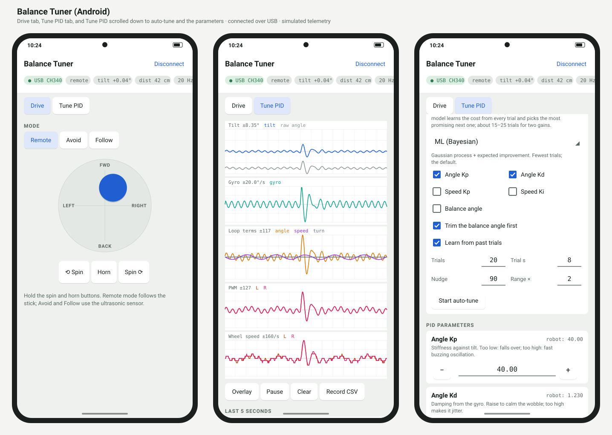

# Balance Tuner app guide (Android)

*English · [Tiếng Việt](ANDROID_APP.vi.md) · [README](README.md) · [Pinout](PINOUT.md) · [Download the APK](releases/BalanceTuner-v1.1.apk)*

Balance Tuner drives the ZYC0049 (PBOT 3.0) balancing robot and tunes its PID live from your
phone, over a USB cable to the Arduino Nano. No Bluetooth and no network needed.

Button and screen names are written in **bold**, exactly as they appear in the app.

*Drawn from the app's layout, colours and chart code with simulated telemetry, not a phone screenshot.*

## What you need

- **A phone** with Android 8.0 or later and USB OTG (USB host) support.
- **An OTG cable or adapter** to plug the Nano's USB cable into the phone.
- **The `BalancingRobotTuner` firmware** flashed on the Nano (see the README). The app does not
  work with the kit's original sketch.
- **The HC-06 Bluetooth module unplugged** from the robot: it shares pins D0/D1 with the Nano's
  USB chip and would talk over it.
- **A charged robot battery**: the phone only powers the Nano over the cable; the motors still
  run from the battery.

The app works with the USB-serial chips found on Nanos: CH340/CH341, CP2102, FT232R/FT-X and
genuine Arduino boards (CDC-ACM).

The robot's pinout, for checking the wiring (D0/D1 are the USB port shared with the HC-06):

## Install

1. Download [`BalanceTuner-v1.1.apk`](releases/BalanceTuner-v1.1.apk) to the phone.
2. Open the file. If Android asks, allow installing apps from that source.
3. Version 1.1 installs over 1.0 without losing data (logs, CSV files).

## Connect

1. Switch the robot on, then plug the Nano's USB cable into the phone through the OTG adapter.
2. Android asks whether to open **Balance Tuner**: open it. The app connects straight away.
3. If there is no question: open the app, tap **Connect**, then allow USB access.
4. Once connected, the status label turns green with a ●. The app reads the robot's current
   parameters and receives telemetry 20 times a second. The screen stays on while connected.

The top bar always shows the current mode (**mode**), the tilt (**tilt**), the ultrasonic distance
(**dist**), the telemetry rate (**Hz**), and the **Motors** switch to turn the motors on or off.

Common messages:

| Message | What it means and what to do |
| --- | --- |
| Robot not found: plug the Nano's USB cable… | No Nano found: check the cable, the OTG adapter, and that the robot is on |
| USB permission is needed… | USB access was refused; tap **Connect** again and allow it |
| USB serial device (a list) | Several USB-serial devices are plugged in; pick the Nano |
| Not connected | This needs a connection; tap **Connect** first |

## Drive tab

- **Joystick**: push up/down to drive forward/back, left/right to turn. Let go to stop.
- **⟲ Spin** / **Spin ⟳**: hold to spin in place anticlockwise / clockwise.
- **Horn**: hold to sound the buzzer.
- **MODE**:
  - **Remote**: the robot follows the joystick.
  - **Avoid**: with a clear path the robot drives forward (green LED); an obstacle closer than
    15 cm makes it turn right (blue LED); closer than 8 cm it backs off (red LED).
  - **Follow**: an object 20–35 cm ahead makes the robot move towards it (green LED); closer than
    20 cm it backs off (blue LED); beyond 35 cm, or nothing seen, it stands still (red LED).

If no control command arrives for 1 second (for example the cable is pulled), the firmware sets
the joystick and horn back to zero.

## Tune PID tab

### Charts

By default each quantity has its own panel:

| Panel | Lines | What to look for |
| --- | --- | --- |
| **Tilt** (°) | tilt (balance angle added), raw angle | tilt should stay near 0 |
| **Gyro** (°/s) | rotation rate around the wheel axle | spikes = the robot jerks |
| **Loop terms** | angle, speed, turn (one shared scale) | which loop does the most work |
| **PWM** | L, R; lines at ±250 | touching ±250 means the motors are at their limit |
| **Wheel speed** (/s) | L, R | wheels turning one way = the robot is drifting |

- **Overlay**: puts every line on one chart, each on its own scale, with checkboxes to show or
  hide each one. Tap **Split** to go back to separate panels.
- **Pause**: freezes the charts so you can look closely.
- **Clear**: clears the charts.
- **Record CSV**: writes the telemetry to `balance_<date>_<time>.csv`, every frame plus the
  parameters in force. Tap **Stop recording** to stop; the app shows the file's path. Files are
  in `Android/data/com.zyc0049.balancetuner/files` on the phone.

### LAST 5 SECONDS: statistics and hints

Statistics for the last 5 seconds: tilt mean, spread (std), peak-to-peak (p-p), oscillation
frequency (osc), mean PWM, saturated share (sat), and mean wheel speed. The hint line below reads
those numbers:

| Hint | What to do |
| --- | --- |
| Fallen over (\|angle\| > 30°)… | The robot fell and the firmware cut the motors; stand it up |
| Motors off… | The motors are off; a good moment to set the balance angle |
| PWM is at its limit…% of the time | Gains too high, or the robot is close to falling |
| Fast oscillation (~… Hz) | Lower Angle Kp or raise Angle Kd |
| Slow rocking (~… Hz) | Lower Speed Kp / Speed Ki |
| Wheels keep turning one way | Check the balance angle, or raise Speed Kp |
| Looks steady. | The robot is standing well |

**Use mean angle as balance angle**: sets the balance angle from the mean raw angle of the last
5 seconds. It only makes sense while the robot is held still at the point where it balances by
itself, or is balancing in place. The app refuses if it has less than a few seconds of data, or
if the robot fell during those 5 seconds.

### PID PARAMETERS

Each parameter has a card: its name, the value the robot is using (**robot: …**), a one-line hint,
an input box, and **−** / **+** buttons.

| Parameter | −/+ step | Kit default | What it does |
| --- | --- | --- | --- |
| Angle Kp | 0.5 | 23 | Stiffness against tilt. Too low: falls over; too high: fast buzzing |
| Angle Kd | 0.02 | 0.48 | Damping from the gyro. Raise to calm the wobble; too high makes it jitter |
| Speed Kp | 0.2 | 5.52 | Holds the wheels still. Too low: drifts away; too high: slow rocking |
| Speed Ki | 0.005 | 0.1098 | Pulls back to the start position. The kit uses about Speed Kp / 50 |
| Turn Kp | 0.5 | 10 | Turning strength when steering |
| Turn Kd | 0.01 | 0.09 | Resists unwanted spinning (gyro z) |
| Balance angle | 0.05 | 6.31 | Mechanical offset in degrees. Wrong value: the robot keeps creeping one way |
| Drive speed | 2 | 30 | Forward/back command at full stick |

- Type a value and press the keyboard's send key, or tap **−** / **+**: the value is sent and
  takes effect at once. **robot: …** shows the value the robot really applied.
- Changes are **lost on reset** until saved.
- **Read**: reads the values back from the robot.
- **Save to robot**: writes them to EEPROM (after a question); the robot uses them after every
  reset.
- **Reload saved**: goes back to the values saved in EEPROM.
- **Kit defaults**: restores the kit's default values (not saved until you tap Save).

### HOW TO TUNE: by hand

This is the procedure from the app's **HOW TO TUNE** section:

1. **Balance angle**: turn **Motors** off, hold the robot upright at the point where it balances
   by itself, and tap **Use mean angle as balance angle**. A wrong value makes it keep creeping
   one way.
2. **Angle loop**: set Speed Kp and Speed Ki to 0. Raise Angle Kp until the robot stands but
   buzzes or shakes quickly, then back off about 40%. Raise Angle Kd until the shaking stops; too
   much Kd shows up as jitter (spiky Gyro and PWM).
3. **Speed loop**: put the kit's Speed Kp back and set Speed Ki to Speed Kp / 50. If it drifts
   away, raise Speed Kp; if it rocks slowly back and forth, lower it.
4. **Watch PWM saturation** in the statistics: above a few % means the motors are at their limit
   and the robot is close to falling.

When you are happy with it, tap **Save to robot**.

### AUTO-TUNE

The robot tries sets of gains on its own while it balances on the floor. Each trial is scored by
a cost (wobble, gyro, wheel drift and travel, PWM saturation; a fall is worst).

**Before you start**: a flat floor with about 1 m free, the USB cable slack. Stand the robot up
again whenever it falls; it balances by itself once upright.

1. **Pick a method** in the list; the hint under it says what the method does:

   | Method | When to use it |
   | --- | --- |
   | ML (Bayesian) | The default; needs the fewest trials (15–25 for two gains) |
   | Neural (deep ensemble) | Neural networks learn the cost instead of a Gaussian process |
   | RL (policy gradient) | Reinforcement learning, 2 trials per update |
   | CMA-ES | Evolution strategy that learns the step size and how the gains interact |
   | Differential evolution, Particle swarm (PSO), Genetic algorithm | Population searches; need 30+ trials |
   | Nelder-Mead, SPSA | Local searches around the current values |
   | Twiddle | One gain at a time, wins re-measured; simple, stays near the start |
   | Random (baseline) | Random samples, for comparison |

2. **Tick the gains to tune** (Angle Kp and Angle Kd by default). Speed Kp, Speed Ki and Balance
   angle (searched within ±3°) can be added.
3. **Trim the balance angle first**: runs one still trial first to set the balance angle.
4. **Learn from past trials**: uses earlier trials from the phone's log when the other gains
   match.
5. **Settings**:
   - **Trials**: the number of trials (20 by default).
   - **Trial s**: seconds per trial (8 by default).
   - **Nudge**: how hard each trial pushes the robot forward and back (90 by default; 0 = no
     push).
   - **Range ×**: the search box, from the current value ÷ Range to × Range. Picking a method
     sets its default Range.
6. Tap **Start auto-tune**. The app asks first, with the expected time, then switches the motors
   on and the telemetry to 25 Hz.
7. **While it runs**: the status line shows each trial (values tried → cost, or a fall) and the
   best set so far. The chart below plots the cost of each trial (log scale, × = fell) and a map
   of the predicted cost over the gains (darker is better).
8. **Stop auto-tune**: stops after the current trial; the best set found stays applied.
9. **At the end** the app lists what changed and asks whether to save it to EEPROM: **Save** or
   **Not now**. Telemetry goes back to 20 Hz.

Trials are logged to `ml_tune_log.csv`, in the same folder as the CSV recordings. That log is
separate from the PC's.

## If something is wrong

- **Connected but no data (– Hz)**: check that the `BalancingRobotTuner` firmware is flashed and
  the HC-06 is unplugged.
- **The robot falls as soon as Motors is on**: tap **Kit defaults**, then set the balance angle
  again as in step 1 of HOW TO TUNE.
- **Auto-tune makes the robot fall in almost every trial**: start from gains that already
  balance, lower Range, or set Nudge to 0.
- **Changes are gone after switching the robot off**: tap **Save to robot** first.
