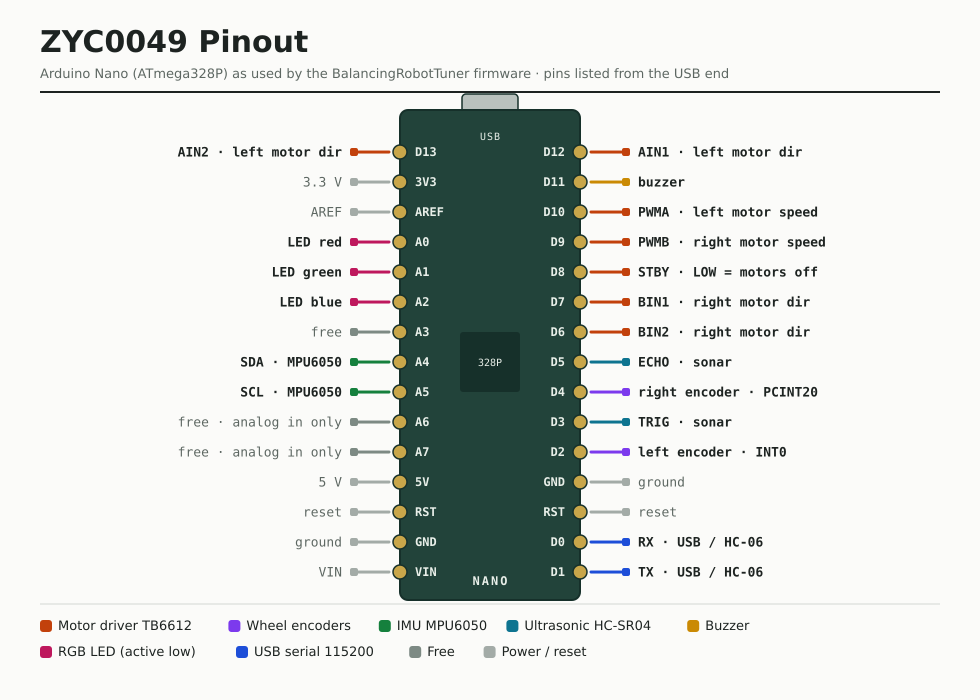
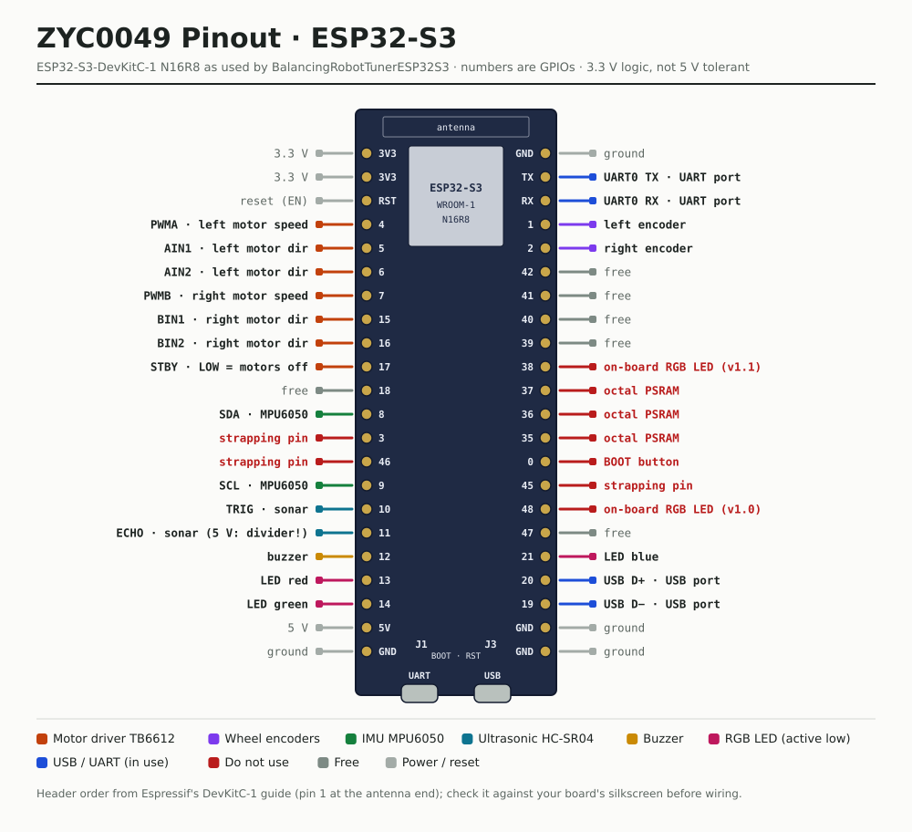
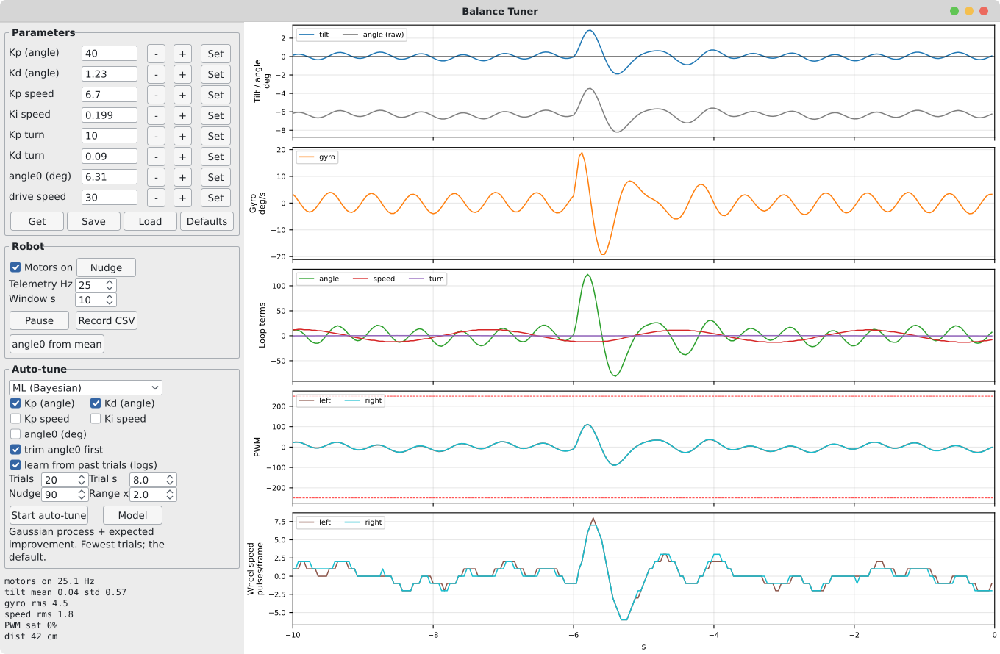

# BalanceTuner

*English · [Tiếng Việt](README.vi.md)*

Live PID tuning and remote control for the ZYC0049 (PBOT 3.0) balancing robot over a USB
cable from the phone (USB OTG) to the Nano. The HC-06 Bluetooth module is not used: unplug
it, it shares D0/D1 with the Nano's USB chip and would talk over it.

- `BalancingRobotTuner/` – firmware: the kit's `BalancingRobot` sketch plus telemetry,
  runtime PID parameters saved in EEPROM, and a motor on/off switch. The wire protocol is
  documented at the top of the `.ino`. The kit's 11-byte control packet still works, so the
  kit's btcontroller app could drive it at 9600 baud (the firmware now runs at 115200).
- `android_app/` – the Balance Tuner app (Kotlin, no libraries; its own small USB-serial
  driver for CH340, CP210x, FT232R and CDC-ACM in `UsbSerialPort.kt`). APK: `~/BalanceTuner.apk`;
  ready-built download: [`releases/BalanceTuner-v1.2.apk`](releases/BalanceTuner-v1.2.apk).
- `BalancingRobotTunerESP32S3/` – the same firmware for an ESP32-S3-DevKitC-1 N16R8, plus Wi-Fi/WebSocket and Bluetooth LE control ([`ESP32S3.md`](ESP32S3.md)).
- `serial_monitor.py` – decodes the same stream on a PC (`/dev/ttyUSB0`).
- [`ANDROID_APP.md`](ANDROID_APP.md) – a step-by-step guide to the Android app: connecting, driving, tuning by hand and auto-tune ([Vietnamese](ANDROID_APP.vi.md)).
- [`PINOUT.md`](PINOUT.md) – which Nano pin goes to which part (motor driver, encoders, IMU, sonar, LED, buzzer).

## Pinout

[](PINOUT.md)

Pin-by-pin tables and notes: [`PINOUT.md`](PINOUT.md).

## Flash the firmware

This Nano's auto-reset does not work, so tap RESET while the upload is trying to connect.

```bash
cd "~/Arduino/ZYC0049 Self Balance/BalanceTuner/BalancingRobotTuner"
arduino-cli compile --fqbn arduino:avr:nano:cpu=atmega328 .
arduino-cli upload  --fqbn arduino:avr:nano:cpu=atmega328 -p /dev/ttyUSB0 .
```

## ESP32-S3 version

`BalancingRobotTunerESP32S3/` is the same firmware for an **ESP32-S3-DevKitC-1 N16R8** wired to
the robot in place of the Nano. Over USB it works with the app and the PC tools as they are. It
can also be driven and tuned over **Wi-Fi**, from a control page the robot serves at
`http://192.168.4.1/` or over a WebSocket, and over **Bluetooth LE** (Nordic UART Service).

[](ESP32S3.md)

Wiring (the ESP32-S3 is 3.3 V only), building, Wi-Fi and Bluetooth: [`ESP32S3.md`](ESP32S3.md).

The control page at `http://192.168.4.1/`, from any phone browser on the robot's Wi-Fi:

<a href="ESP32S3.md#wi-fi-control-page-and-websocket"></a>

## Build the app

```bash
cd "~/Arduino/ZYC0049 Self Balance/BalanceTuner/android_app"
JAVA_HOME=~/Android/jdk ANDROID_HOME=~/Android/Sdk ~/Android/gradle-8.7/bin/gradle --no-daemon assembleRelease
cp app/build/outputs/apk/release/app-release.apk ~/BalanceTuner.apk
```

This uses the Gradle 8.7 already installed in `~/Android/gradle-8.7`. `./gradlew` works too, but
it first downloads Gradle from the Tencent mirror, and on this machine that download breaks off
partway. The first build also downloads the Android build libraries, so it needs a network.

## Use


*Drawn from the app's layout, colours and chart code with simulated telemetry, not a phone screenshot.* Step by step: [`ANDROID_APP.md`](ANDROID_APP.md).

Connect the Nano's USB port to the phone with an OTG adapter/cable. Android offers to open
Balance Tuner and connects straight away; otherwise open the app, tap Connect and allow USB
access. The phone powers the Nano over the cable; the motors still run from the battery.
**Drive** has the joystick, spin and horn buttons, and the Remote/Avoid/Follow modes.
**Tune PID** has live charts: by default one panel per term, as in `tuner_gui.py` (tilt and
raw angle, gyro, angle/speed/turn loop terms on one shared scale, PWM L/R with ±250
saturation lines, wheel speed L/R); Overlay switches to the single chart with every series
scaled on its own and per-series checkboxes. Below them,
statistics for the last 5 s with hints, editors for each parameter (applied immediately),
Save to robot (EEPROM), and Record CSV. The app's "How to tune" section gives the procedure.

## Debug from a PC

With the Nano on the PC's USB, the Arduino Serial Monitor/Plotter at 115200 (or
`python3 serial_monitor.py --text`) shows readable lines, the default at power-on (`d` brings
them back after binary),
`tilt:0.12 angle:0.29 gyro:-1.3 A:4 S:-12 T:0.0 pwmL:-8 pwmR:-8 pulL:0 pulR:0 dist:42 motors:1 fallen:0 mode:1`,
after a line with the current parameters. `b`, or the app connecting, switches back to
binary. Without `--text`, `serial_monitor.py` decodes the binary frames.

## Tune with live graphs from a PC



*`tuner_gui.py` with simulated telemetry: the robot balancing in place, nudged 6 s ago.*

`python3 tuner_gui.py [/dev/ttyUSB0]` (Tkinter + matplotlib + pyserial) is the PC version of
the app's Tune PID screen: scrolling charts of tilt/raw angle, gyro, the angle/speed/turn loop
terms, PWM (±250 saturation marked) and wheel speed, each loop term on its own trace as in
farrellf's Balancing_Robot_Firmware. Beside them: editors for every parameter (Enter/Set
applies at once, -/+ = ±10 %, angle0 ±0.1°), Get/Save/Load/Defaults, motors on/off, telemetry
rate, a Nudge (forward then back) to watch the recovery, window statistics, "angle0 from
mean" trim, and Record CSV (telemetry plus the parameters in force). Close the Arduino
Serial Monitor first; closing the window switches the robot back to text mode.

### `tuner_gui.py` in detail

**Start.** `python3 tuner_gui.py [port] [-b baud] [--window s]` (defaults `/dev/ttyUSB0`,
115200, 10 s). It needs `python3-tk`, matplotlib, numpy and pyserial. Opening the port resets
the Nano, so the GUI waits 2.5 s, then switches the robot to binary telemetry (`b`), sets the
telemetry rate and reads the parameters. If that fails, the red status line at the bottom
says so; check the port and press **Get**. Closing the window stops the wheels and puts the
robot back in text mode (`d`) for the Serial Monitor.

**Layout.** Left: the Parameters, Robot and Auto-tune panels, the statistics and the status
line. Right: five charts on one time axis, the last *Window s* seconds (0 = now), redrawn
every 100 ms:

| Chart | Series | What to look for |
| --- | --- | --- |
| Tilt / angle (deg) | tilt = angle + angle0, raw angle; black line at 0 | tilt should stay near 0. Fast buzzing: Kp too high. Slow wobble: more Kd |
| Gyro (deg/s) | rate around the wheel axle (what Kd multiplies) | spikes = jerks; RMS is in the statistics |
| Loop terms | angle term (Kp, Kd), speed term (speed Kp, Ki), turn term | which loop does the work; a large speed term fighting the angle term is slow rocking |
| PWM | left / right motor command; red dashed lines at ±250 | touching ±250 = saturated: the motors have nothing left to recover with |
| Wheel speed | encoder pulses per frame, left / right | drifting away: speed Kp too low; slow back-and-forth: speed Kp too high |

**Parameters panel.** One row per parameter: Kp/Kd (angle), Kp/Ki speed, Kp/Kd turn, angle0
(deg) and drive speed. Type a value and press Enter or **Set**: it is clamped to the firmware
limits (Kp 0–100, Kd 0–10, speed Kp 0–50, speed Ki 0–2, turn Kp 0–50, turn Kd 0–5, angle0
±15°, drive speed 0–100). The robot then echoes the value it really applied, and the box shows
that echo. **−/+** change a gain by 10 % and angle0 by 0.1°. Changes act at once but are lost
at power-off until saved. **Get** re-reads the robot, **Save** writes EEPROM (after a
question), **Load** goes back to what EEPROM holds, **Defaults** to the firmware's defaults.

**Robot panel.**
- **Motors on**: switches the motors on or off.
- **Nudge**: drives forward for 0.4 s, then back for 0.4 s, so you can watch the robot recover.
- **Telemetry Hz**: 1–25 frames per second (25 by default).
- **Window s**: how many seconds the charts show (2–40).
- **Pause**: freezes the charts. Telemetry keeps arriving, and recording continues.
- **Record CSV**: writes every frame (`host_s`, the telemetry fields) plus the 8 parameters in
  force at that moment.
- **angle0 from mean**: with the robot balancing in place, offers angle0 = −(mean raw angle)
  over the visible window. It needs at least 20 frames.

**Statistics** (over the visible window): state (motors on / motors off / FALLEN), received
frame rate, tilt mean and spread, gyro RMS, wheel speed RMS, share of PWM-saturated frames,
and the ultrasonic distance.

**Auto-tune panel.**
- **Method list**: pick a method; the hint under it says what the method does. Picking a
  method also sets its Range.
- **Gains to tune**: tick them (angle Kp and Kd by default; speed Kp, speed Ki and angle0
  optional).
- **trim angle0 first**: one still trial first, then sets angle0 = −mean angle.
- **learn from past trials**: earlier runs' logs feed the model, when their other gains match.
- **Settings**: Trials 5–80 (default 20), Trial s 4–20 (8), Nudge 0–127 (90; 0 = no push),
  Range × 1.2–5 (the search box is current ÷ Range to current × Range).
- **Start auto-tune**: asks first, with the expected time (trials × (trial s + 3) ÷ 60 min).
  It then switches the motors on and the telemetry to 25 Hz, because the cost's wheel speed
  is per frame.
- **During the run**: the info line shows each trial's values, then its cost or FELL, and the
  best set so far with its predicted cost.
- **Stop auto-tune**: stops after the current trial, and the best set found stays applied.
- **At the end**: lists what changed and asks whether to write it to EEPROM.

**One trial**, the same for every method and in `autotune.py`:
1. Wait until the robot has stood for 1.5 s with the last parameters: at least 25 frames,
   raw angle within ±15°, not fallen.
2. Apply the new set, then wait 1.5 s for it to settle.
3. After 1 s, nudge it forward 0.4 s and back 0.4 s (unless Nudge is 0).
4. Measure until *Trial s* is up, or until it falls. A fall is the firmware's fallen flag or
   a raw angle beyond ±30°.

The cost is

  angle std + 0.1 × gyro RMS + 0.2 × wheel-speed RMS + 0.005 × travel + 20 × saturated share

where travel is the largest distance from the start in encoder pulses. A fall costs
100 + 10 × the seconds it did not last. After a fall the best set is put back, and the tuner
waits for you to stand the robot up; it balances by itself once upright.

**Model window** (**Model** button; opens at the first trial):
- **Left chart**: the cost of each trial, on a log scale. A red × is a fall; the green step
  line is the best trial so far; the dashed line is the model's predicted best (for Twiddle,
  the mean of its two confirming trials).
- **Right chart, one gain ticked**: the model's predicted cost against that gain, with a band
  of ±2 standard deviations.
- **Right chart, two or more gains**: a colour map of the first two gains, dark meaning
  better, with any other gains held at their best. The white star is the best set; red dots
  are falls, grey ones past runs. Gains are on log axes, angle0 on a linear one.

**Files.** Every trial is appended to `ml_tune_log.csv` next to the script: trial number,
stage (`method:gains`), the 8 parameters, cost, fell, angle mean and std, gyro RMS, speed
RMS, travel and saturation. That log and `autotune_log.csv` are what "learn from past trials"
reads.

**If something is wrong.**
- **"no telemetry" or "no reply from the robot"**: another program holds the port (close the
  Arduino Serial Monitor), or the port is wrong (try `/dev/ttyACM0`).
- **Permission denied on the port**: add yourself to the `dialout` group and log in again.
- **The robot falls during almost every trial**: start from parameters that already balance,
  lower Range, or set Nudge to 0.

## Auto-tune from a PC

`python3 autotune.py` tunes the parameters on its own while the robot balances on the floor
(~1 m free, USB cable slack, Serial Monitor closed). It trims `angle0` from the mean angle
the robot settles at, then searches angle Kp/Kd and speed Kp/Ki, scoring each 8 s trial from
the telemetry: angle spread, gyro RMS, wheel speed and travel from the encoders, PWM
saturation; a fall scores worst. Each trial nudges the robot forward and back so it must
recover (`--no-nudge` to stay in place). After a fall it restores the best parameters and
waits for you to stand the robot up. It asks before saving to EEPROM and logs every trial
to `autotune_log.csv`. `--stages angle`, `--trial`, `--max-trials`: see `--help`.

### Auto-tune in the GUI: eleven methods

`tuner_gui.py` has an **Auto-tune** panel (`ml_tune.py`, numpy only) that runs the method
picked in its list on the ticked gains, with the same trials, cost, fall recovery, Stop, trial
log, Model window and save prompt for all of them. Twiddle and ML (Bayesian) are described
below; the others:

| Method | Family | Notes |
| --- | --- | --- |
| Neural (deep ensemble) | deep learning surrogate | 5 small neural nets (32-32, tanh, Adam, numpy) learn the cost; next trial = lowest mean − 1.5 × spread |
| RL (policy gradient) | reinforcement learning | PGPE: Gaussian policy over the gains, symmetric pairs of trials as episodes |
| CMA-ES | evolution strategy | adapts step size and gain correlations; ~6–8 trials per generation |
| Differential evolution | evolutionary | DE/rand/1/bin; give it 30+ trials |
| Particle swarm (PSO) | swarm | give it 30+ trials |
| Genetic algorithm | evolutionary | tournament, blend crossover, mutation, elitism; 30+ trials |
| Nelder-Mead | direct search | local simplex, no model; noise can fool it |
| SPSA | stochastic gradient | 2 trials per gradient estimate, extremum-seeking style; local |
| Random (baseline) | – | Latin-hypercube samples; what a method must beat to be worth it |

All but Twiddle report the tried set with the lowest cost *predicted* by the Model window's
Gaussian process, as ML does, so a single lucky trial does not win. On a simulated noisy cost
all of them moved Kp/Kd from the start to near the optimum in 25 trials; on the robot, ML
(Bayesian) still needs the fewest. Not included: Ziegler–Nichols, Cohen–Coon and relay
(Åström–Hägglund) tuning need the open-loop plant to be stable or a sustained oscillation,
and a balancing robot falls under both; online RL or fuzzy gain scheduling inside the 200 Hz
loop would need firmware changes. The app (`AutoTuner.kt`) has all eleven too.

- **Twiddle** is `autotune.py`'s search run from the GUI. It steps one gain at a time
  (start ±25 %), and a win is re-measured before it is kept. Range defaults to ×3 as in
  `autotune.py`. Ticking all four gains tunes them together, not in stages. Here the Model
  window's map only pictures the trials; it does not steer the search.
- **ML (Bayesian)**, the default, is described below.

Besides the four gains, **angle0** (balance angle) can be ticked. It is an offset, not a gain,
so it is searched linearly within the current value ±3°, and Twiddle steps it in degrees
(±0.75° first). A wrong angle0 shows up in the cost as wheel drift and travel. The one-shot
"trim angle0 first" (angle0 = −mean angle) is still offered as a start. All trials go to
`ml_tune_log.csv`. `autotune.py` still works on its own from the command line.

**ML (Bayesian)** uses Bayesian optimisation: a Gaussian process learns the cost surface over the ticked gains (angle Kp/Kd by
default, speed Kp/Ki optional) from every trial. That includes falls, and also past trials
from `ml_tune_log.csv`/`autotune_log.csv` when the other gains match. Each next trial goes
where the expected improvement is highest. Trials and the cost are the same as
`autotune.py`. The search box runs from current ÷ Range to current × Range, on a log scale.
The result is the tried set with the lowest *predicted* cost, so one lucky trial does not
win. Expect 15–25 trials for two gains. The **Model** window plots the cost of every trial
and the model's predicted-cost map (falls in red, past runs in grey). Stop keeps the best
found so far. At the end the GUI asks before saving to EEPROM.

The app has the same feature in a native Kotlin port (`AutoTuner.kt`, `ModelView.kt`, no
libraries) under **Tune PID → Auto-tune**. It offers the same eleven methods in a list, with
the same settings and cost, and a chart of the cost per trial and the predicted-cost map. It switches
telemetry to 25 Hz while it runs, so its costs compare with the PC's, then back to 20 Hz.
Trials are logged to `ml_tune_log.csv` in Android/data/com.zyc0049.balancetuner/files. That
log is separate from the PC's, so each one learns only from its own past trials.

The link runs at 115200 baud (firmware `Serial.begin`, app `SerialLink.BAUD`, and
`serial_monitor.py -b` must agree). 20 Hz telemetry uses about 5% of it. The kit's
btcontroller app and an HC-06 at its default 9600 baud no longer work with this firmware.
