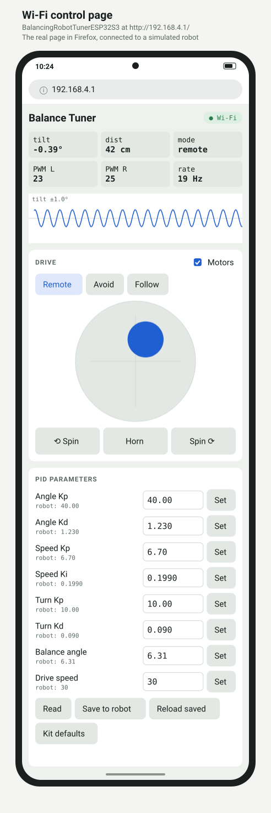

# Balancing robot guide: read data, set the balance point, tune the PID

For the ZYC0049 (PBOT 3.0) robot running the `BalancingRobotTuner` firmware, connected to the
PC by USB (`/dev/ttyUSB0`). All commands run from this folder:

```bash
cd "/home/vu/Arduino/ZYC0049 Self Balance/BalanceTuner"
```

Only one program can use the serial port at a time. Close the Arduino Serial Monitor before
uploading or running `autotune.py` / `serial_monitor.py`, otherwise you get
`Device or resource busy` or `Input/output error`.

---

## 1. Upload the firmware

```bash
arduino-cli compile --fqbn arduino:avr:nano BalancingRobotTuner
arduino-cli upload  --fqbn arduino:avr:nano -p /dev/ttyUSB0 BalancingRobotTuner
```

- This Nano's auto-reset does not work: **tap the RESET button** while the upload is trying
  to connect.
- `not in sync` errors: the Nano has the old bootloader, use
  `--fqbn arduino:avr:nano:cpu=atmega328old` (Arduino IDE: Processor → ATmega328P (Old Bootloader)).
- Arduino IDE instead: Board **Arduino Nano**, Port `/dev/ttyUSB0`, Upload.

---

## 2. Read the data

**Baud rate: 115200** (8N1). The kit's original sketch used 9600; this firmware does not.

### Arduino Serial Monitor (or Serial Plotter)

Open it at **115200**. After power-on the robot prints one parameter line, then about 20 lines
per second:

```
# text debug ('b' = binary). kp:23.00 kd:0.480 kp_speed:5.520 ki_speed:0.1098 kp_turn:10.00 kd_turn:0.090 angle0:6.31 drive_speed:30 telemetry_hz:20
tilt:0.12 angle:-6.19 gyro:-1.3 A:4 S:-12 T:0.0 pwmL:-8 pwmR:-8 pulL:0 pulR:0 dist:42 motors:1 fallen:0 mode:1
```

| Field | Meaning |
| --- | --- |
| `tilt` | `angle + angle0`: the error the balance loop drives to 0. Near 0 when standing = good |
| `angle` | raw tilt from the MPU6050 (Kalman filtered), degrees |
| `gyro` | tilt rate, deg/s. Large values while standing = shaking/oscillation |
| `A` | angle loop output, `kp × tilt + kd × gyro` |
| `S` | speed loop output (keeps the wheels from drifting) |
| `T` | turn loop output |
| `pwmL` `pwmR` | motor commands, −255…255. Stuck at ±255 = saturated |
| `pulL` `pulR` | encoder pulses since the last line (wheel speed) |
| `dist` | ultrasonic distance, cm |
| `motors` | 1 = motor driver on |
| `fallen` | 1 = more than 30° from vertical; the firmware cuts the motors |
| `mode` | 1 remote, 2 obstacle avoidance, 3 follow |

Keys you can send from the Serial Monitor input box:

- `d`: readable text lines (the default at power-on)
- `b`: binary frames (what the phone app and tools use). The app switches it automatically.

If you see garbage like `⸮Z⸮⸮Z⸮⸮`, the robot is in binary mode: send `d`.

### From a terminal

```bash
python3 serial_monitor.py --text            # the same text lines
python3 serial_monitor.py                   # decodes the binary frames
python3 serial_monitor.py --csv log.csv     # also save telemetry to a CSV file
```

---

## 3. Set the balance point (`angle0`)

The sensor is rarely mounted exactly level and the weight is rarely centred, so the angle at
which the robot really balances is not 0. `angle0` corrects that: the firmware balances
`tilt = angle + angle0` to zero.

1. Open the Serial Monitor (text mode).
2. Hold the robot at the angle where it balances, still (`gyro` near 0), for a few seconds.
3. Read `angle` over several lines and average it. Example: `angle` ≈ −6.31.
4. `angle0` = minus that average → **6.31**.

Set it with one of:

- **Phone app:** Tune PID → Balance angle → 6.31 → *Save to robot*.
- **Firmware default:** `PARAM_DEFAULT[]` (6th value) and `float angle0 = …` in
  `BalancingRobotTuner.ino`, then upload. Note: values saved to EEPROM override the firmware
  defaults. If the parameter line still shows the old value after upload, press *Defaults* then
  *Save to robot* in the app.
- **Automatically:** `autotune.py` does this as its first step (next section).

Signs it is wrong: the robot keeps creeping in one direction, or `S` stays large on one side
while it stands still.

---

## 4. Automatic tuning (`autotune.py`)

The script tries parameter sets while the robot balances on the floor and keeps the ones that
make it steadiest, judged from the robot's own IMU, encoders and motor output.

### Before you start

- Flat floor, about **1 m of free space** around the robot (it is nudged forward and back).
- USB cable slack or tied up so it does not pull the robot.
- Battery charged (a weak battery makes every result worse).
- Serial Monitor **closed**.
- Stay next to the robot: you stand it up when it falls.

### Run

```bash
python3 autotune.py
```

When it says `>> stand the robot up`, hold the robot upright and let go once it is
balancing. A full run takes about 10–20 minutes.

### What it does

| Step | What changes | How |
| --- | --- | --- |
| 1. `angle0` | balance point | robot left alone; `angle0 = −(mean angle)` |
| 2. `angle` | `kp`, `kd` | search |
| 3. `speed` | `kp_speed`, `ki_speed` | search |
| 4. `angle0` | balance point | trimmed again with the new gains |

Each trial (8 s): apply the values → settle 1.5 s → nudge the robot forward and back → measure.
The search changes one parameter at a time by ±25%, keeps a change only if it scores better
twice in a row, and shrinks the step as it closes in.

### Reading the output

```
  #7   kp=28.75  kd=0.6  kp_speed=5.52  ki_speed=0.1098  angle0=6.228  ->  cost 2.20  (ang_std=0.57 gyro=11.1 spd=1.8 travel=34 sat=0%)
  ++ kd = 0.6  (best cost 2.19)
```

Lower `cost` is better. It adds up:

| Term | Measures | From |
| --- | --- | --- |
| `ang_std` | how much the robot wobbles, degrees | IMU angle |
| `gyro` | shaking / oscillation, deg/s RMS (× 0.1) | IMU gyro |
| `spd` | wheel speed RMS, pulses per frame (× 0.2) | encoders |
| `travel` | furthest the robot wandered, pulses (× 0.005) | encoders |
| `sat` | share of time the motors were at full power (× 20) | PWM |

A fall costs 100 or more, and is never kept. `++` marks an accepted improvement.

### When it falls

That is expected now and then: a candidate was too soft or too aggressive. The firmware cuts
the motors, the script goes back to the best values, prints `>> stand the robot up` and waits.
New values are only applied once the robot is balancing again.

### Finish

At the end it prints the result next to the old values and asks `save to EEPROM? [y/N]`.

- `y`: kept after power-off.
- `N`: active only until the next power-off or reset. Test-drive first, save later from the app.

**Ctrl+C** at any time stops it and keeps the best values found so far (not saved).
Every trial is logged in `autotune_log.csv`.

### Options

```bash
python3 autotune.py --stages angle          # only kp/kd
python3 autotune.py --stages angle0         # only the balance point
python3 autotune.py --no-nudge              # no room: the robot stays in place
python3 autotune.py --trial 6               # shorter trials (noisier)
python3 autotune.py --max-trials 50         # longer search per stage
python3 autotune.py --save                  # save to EEPROM without asking
python3 autotune.py /dev/ttyUSB1            # another port
```

If the result feels too stiff (buzzing) or too soft (sluggish), change the weights in
`measure()` in `autotune.py`: raise the `gyro` weight to penalise buzzing, raise the
`travel` weight to keep the robot more in place.

---

## 5. Manual tuning

Use the phone app (Tune PID page: live chart, values applied immediately) or check the
effect in the Serial Monitor. Tune in this order, one parameter at a time:

| Parameter | Default | Too low | Too high |
| --- | --- | --- | --- |
| `angle0` | 6.31 | robot creeps one way | creeps the other way |
| `kp` (angle) | 23 | falls over, sluggish | fast buzzing oscillation |
| `kd` (angle) | 0.48 | wobbles back and forth | jitters, noisy motors |
| `kp_speed` | 5.52 | drifts away | slow rocking |
| `ki_speed` | 0.1098 | does not return to its start | slow large swings (keep ≈ `kp_speed` / 50) |
| `kp_turn` | 10 | turns weakly | jerky turns |
| `kd_turn` | 0.09 | spins on its own | twitchy |
| `drive_speed` | 30 | slow driving | falls when driving |

1. Set `angle0` (section 3).
2. Set `kp_speed` and `ki_speed` to 0 and raise `kp` until the robot oscillates quickly, then
   use about 60% of that value.
3. Raise `kd` until the wobble is damped, back off if the motors start to jitter.
4. Bring back `kp_speed`, then `ki_speed` (≈ `kp_speed` / 50) until it holds its place.
5. Save to EEPROM.

**From a phone browser (ESP32-S3 version).** With the
[`BalancingRobotTunerESP32S3`](ESP32S3.md) firmware, the same steps work without a PC or the app:
join the robot's Wi-Fi (`BalanceTuner-XXXX`, password `balance123`) and open
**http://192.168.4.1/**. The page sets each parameter (type a value, **Set**), saves with
**Save to robot**, and shows the tilt over the last 10 seconds. It has no per-term charts or
statistics, so for steps 2–4 the phone app or `tuner_gui.py` show more; see the
[ESP32-S3 guide](ESP32S3.md#wi-fi-control-page-and-websocket).

<a href="ESP32S3.md#wi-fi-control-page-and-websocket"></a>

---

## 6. Troubleshooting

| Problem | Fix |
| --- | --- |
| Garbage characters in the Serial Monitor | wrong baud (use 115200) or binary mode (send `d`) |
| `Device or resource busy` / `Input/output error` | another program has the port: close the Serial Monitor / IDE |
| `Permission denied` on `/dev/ttyUSB0` | `sudo usermod -aG dialout $USER`, then log out and in |
| Upload `not in sync` | tap RESET during upload; or use the old-bootloader board option |
| New firmware default not used | EEPROM values override it: app *Defaults* → *Save to robot* |
| `autotune.py`: `no ack` / `no telemetry` | wrong port, Serial Monitor open, or old firmware on the Nano |
| `autotune.py` waits at "stand the robot up" | it needs 1.5 s within 15° and not fallen; check `motors:1` |
| Robot cuts out while leaning | normal past 30°; also when the wheels spin freely while lifted |
| Results get worse during a session | battery running low: charge and rerun |
